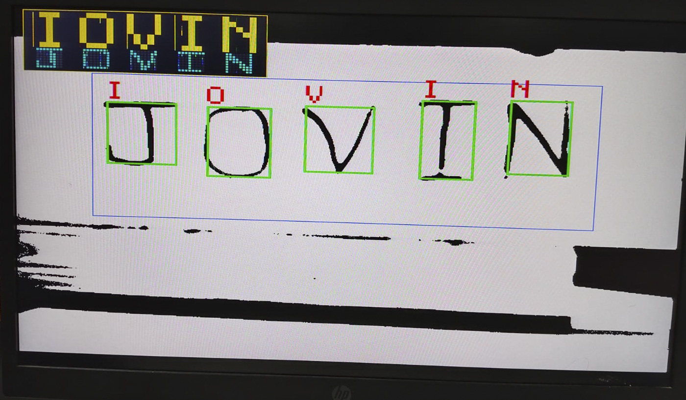
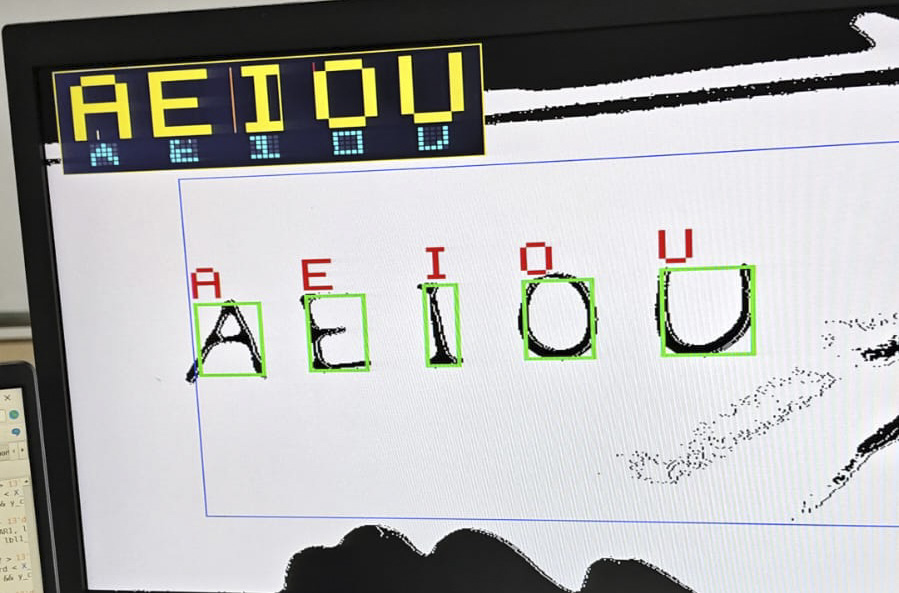
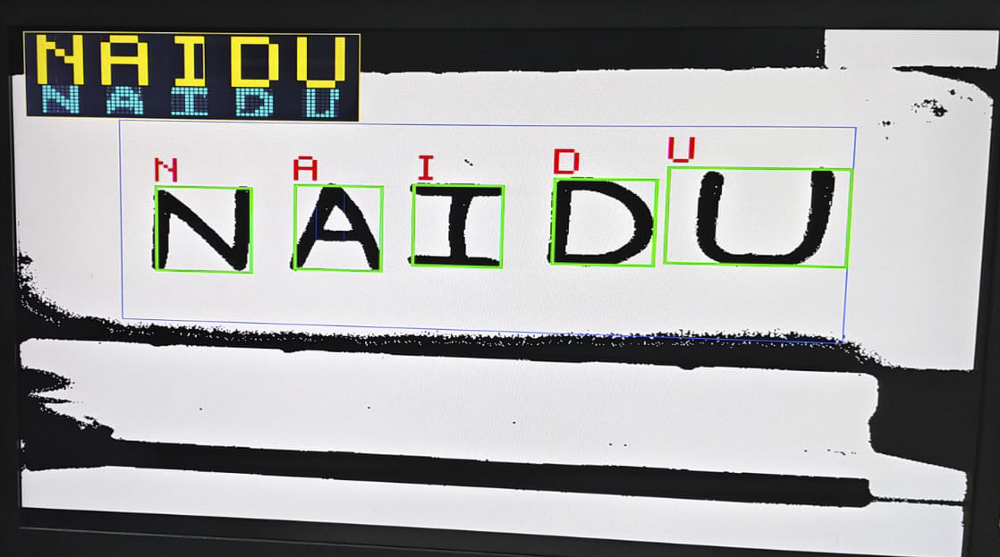

# Real-Time Optical Character Recognition (OCR) on FPGA

Real-time hardware implementation of an **Optical Character Recognition (OCR)** pipeline on the **Terasic DE2-115 (Intel Cyclone IV E `EP4CE115F29C7`)** FPGA board. The system captures live video from a **TRDB-D5M 5-Megapixel CMOS camera**, performs on-the-fly image binarization, morphological noise filtering, multi-character bounding-box segmentation, and **8×8 (64-bit) Morphological Hit-or-Miss & Topological Template Matching** at 60 FPS with a live **VGA On-Screen Display (OSD) HUD**.

---

## System Architecture & Pipeline

1. **CMOS Frame Acquisition (`CCD_Capture.v`, `RAW2RGB.v`, `Sdram_Control/`):**
   * Interfaces with the TRDB-D5M camera module over I2C (`I2C_CCD_Config.v`) and buffers 640×480 frames through external SDRAM.
2. **Adaptive Binarization & Persistence Filtering (`text_binarizer.v`, `Detector.v`):**
   * Converts RGB pixels into binary foreground/background (`pixel_is_black`) inside a 600×235 safe detection window (`X: 310..909`, `Y: 130..365`).
   * Applies horizontal run-length filtering (`3px` to `180px`) and a 2-row vertical persistence filter to reject salt-and-pepper noise and notebook border shadows while preserving wide horizontal bars (`T`, `Z`, `H`, `L`, `E`).
3. **Multi-Character Bounding-Box Segmentation (`Detector.v`):**
   * Accumulates a 600-bit column projection bitmap (`col_ink`) and 38 vertical strip trackers (`strip_y_min` / `strip_y_max`) to dynamically isolate up to **5 simultaneous characters** (`X_MIN0..4`, `X_MAX0..4`, `Y_MIN0..4`, `Y_MAX0..4`) with 5-pixel white-gap tolerance and 3-pixel coordinate hysteresis.
4. **8×8 Morphological Core Sampling & Classification (`Detector.v`):**
   * Normalizes each character bounding box into an **8×8 (64-bit) spatial grid** (`get_zone8x8`) using zero-division binary bit-shifts (`<< 3`, `<< 2`, `<< 1`).
   * Samples eroded 5-pixel stroke cores (`h_core_ink`) so thick marker strokes do not flood interior cavities (`A`, `B`, `D`, `O`, `P`, `Q`, `R`, `0`, `6`, `8`, `9`).
   * Combines **structural cavity/spine rules** with a **64-bit Hamming-distance template matcher (`popcount64`)** and automatic word/number context disambiguation (`0`/`O`, `1`/`I`, `5`/`S`, `8`/`B`, `2`/`Z`).
5. **Real-Time VGA HUD & Hardware Display (`DE2_115_CAMERA.v`, `LCD_Driver.v`):**
   * Draws green bounding boxes around each detected character, floating 4× yellow character labels above each box, and a top-left **OSD HUD** showing 8× recognized characters alongside live **8×8 cyan debug dot grids**.
   * Simultaneously outputs recognized characters to the DE2-115 **16×2 LCD screen** and **7-segment displays (`HEX0..HEX7`)**.

---

## Hardware Controls (DE2-115)

| Control | Function |
| :--- | :--- |
| **`KEY[0]`** | Global System Reset |
| **`KEY[1]`** | Camera CMOS Exposure Adjustment (hold with `SW[0]` to tune contrast) |
| **`KEY[2]`** | Freeze / Pause (`iPAUSE`) — locks bounding boxes, 8×8 grids, and HUD predictions |
| **`KEY[3]`** | Restart Capture Pipeline |
| **`SW[0]`** | Exposure Direction (`0` = Increase Exposure, `1` = Decrease Exposure) |
| **`SW[2]`** | Priority Mode (`1` = Force Alphabet Priority for `O/I/S/B/Z`, `0` = Auto Context) |
| **`SW[16]`** | Display Mode Toggle (Binarized OCR View vs. Raw RGB Camera Feed) |

---

## Experimental Results & Live VGA Output

### 1. Real-Time Multi-Character Segmentation & 8×8 HUD Recognition
<p align="center">
  
</p>

### 2. Bounding-Box Tracking & Cyan 8×8 Normalized Grid Visualization
<p align="center">
  
</p>

### 3. Character & Word Recognition Output
<p align="center">
  
</p>

---

## Repository Structure

```text
FPGA_RealTime_OCR/
├── DE2_115_CAMERA.qpf                       # Quartus Prime Project File
├── DE2_115_CAMERA.qsf                       # Quartus Settings & Pin Assignments (EP4CE115F29C7)
├── DE2_115_CAMERA.sof                       # Pre-compiled FPGA Bitstream for direct programming
├── DE2_115_CAMERA.qar                       # Quartus Prime Archive File (Full self-contained project)
├── DE2_115_CAMERA.v                         # Top-level module integrating Camera, SDRAM, OCR, VGA & LCD
├── DE2_115_D5M_VGA.SDC                      # Synopsys Design Constraints (Timing)
├── DE2_115_CAMERA_assignment_defaults.qdf   # Quartus default assignment settings
├── text_binarizer.v                         # RGB-to-Binary threshold module
├── VGA_Param.h                              # VGA timing parameters
├── v/                                       # Core HDL & IP modules
│   ├── Detector.v                           # 5-Box Segmenter, 8x8 Grid Sampler, Classifier & VGA OSD HUD
│   ├── CCD_Capture.v                        # TRDB-D5M frame capture
│   ├── RAW2RGB.v                            # Bayer-to-RGB conversion
│   ├── I2C_CCD_Config.v                     # Camera sensor register configuration
│   ├── I2C_Controller.v                     # I2C bus master
│   ├── VGA_Controller.v                     # VGA sync & coordinate generator
│   ├── LCD_Driver.v                         # 16x2 Character LCD controller
│   ├── SEG7_LUT.v / SEG7_LUT_8.v            # 7-Segment display decoders
│   ├── Line_Buffer.v / Line_Buffer1.v       # Line buffers for spatial filtering
│   ├── Reset_Delay.v                        # Power-on reset delay generator
│   └── sdram_pll.v                          # Clock generation PLL
├── Sdram_Control/                           # 2-Port SDRAM Frame Buffer Controller
└── images/                                  # Hardware test results & VGA monitor captures
